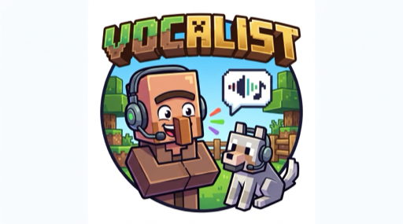

<p align="center">
  
</p>

# Vocalist

Talk to any creature on your Minecraft server.

<p align="center">
  <video src="https://github.com/bbenshab/vocalist/releases/download/v1.0.0/we-speak.mov" controls width="640"></video>
</p>

Vocalist is a server-side Forge 1.20.1 mod that gives every living entity a
voice. Sneak + right-click a creature with an empty hand and it starts a
conversation: type in chat (or speak, with Simple Voice Chat) and the creature
answers in character, remembers previous chats, and can talk back out loud.

## Features

- **Universal NPC dialogue** - villagers, wolves, zombies, CustomNPCs, anything
  living. Each entity type gets its own persona from the config.
- **Provider chain** - Gemini first, any OpenAI-compatible endpoint (Grok,
  Ollama, llama.cpp) as fallback. Automatic failover on errors.
- **Persistent memory** - every creature remembers its last conversations,
  stored in the world save.
- **Voice input** - speak into your mic during a conversation; transcription
  via Gemini or local faster-whisper (offline, free). Requires Simple Voice
  Chat 1.20.1-2.5.34+ on the server (clients only need Simple Voice Chat
  itself).
- **Voice output** - creature replies are spoken through Simple Voice Chat via
  Gemini neural TTS, with espeak-ng as an offline fallback.
- **Privacy by design** - the mic is only listened to while a conversation is
  actually open. No idle eavesdropping, no runaway API calls.
- **Server-side only** - players don't need to install anything.

## Requirements

| Dependency | Version | Required for |
|---|---|---|
| Minecraft Forge | 1.20.1 (47.x) | Always |
| [Simple Voice Chat](https://modrinth.com/mod/simple-voice-chat) | 1.20.1-2.5.34 or newer (tested with 2.5.34) | Voice input and output (text chat works without it) |

## Setup

1. Drop `vocalist-1.0.0.jar` into `mods/` together with Simple Voice Chat
   (Forge 1.20.1, Simple Voice Chat 1.20.1-2.5.34 or newer for voice features).
2. Start the server once - `config/vocalist.json` is generated with defaults.
3. Add your API keys under `providers` (see below).
4. `/vocalist reload` to apply.

## Configuration

All settings live in `config/vocalist.json`, created with defaults on first
run. Changes apply immediately with `/vocalist reload` - no restart needed.

```json
{
  "systemPrompt": "...",
  "personas": {
    "minecraft:villager": "a shrewd villager who barters hard ...",
    "customnpcs:customnpc": "a distinctive local character ..."
  },
  "providers": [
    {
      "name": "gemini",
      "type": "gemini",
      "baseUrl": "https://generativelanguage.googleapis.com",
      "apiKey": "YOUR_GEMINI_KEY",
      "model": "gemini-3.1-flash-lite"
    },
    {
      "name": "grok",
      "type": "openai",
      "baseUrl": "https://api.x.ai/v1",
      "apiKey": "YOUR_XAI_KEY",
      "model": "grok-3-mini"
    }
  ],
  "ttsMode": "off",
  "sttMode": "off"
}
```

### Providers

The chain is tried top to bottom; the first provider to answer wins.

| Field | Meaning |
|---|---|
| `name` | Display name shown in `/vocalist status` |
| `type` | `gemini` or `openai` (works for Grok, Ollama, llama.cpp - any OpenAI-compatible endpoint) |
| `baseUrl` | API root (no trailing slash) |
| `apiKey` | API key; leave empty for local endpoints like Ollama |
| `model` | Model name to use |

#### Example: Grok (xAI)

Grok's API is OpenAI-compatible. Create a key at
[console.x.ai](https://console.x.ai):

```json
{
  "name": "grok",
  "type": "openai",
  "baseUrl": "https://api.x.ai/v1",
  "apiKey": "YOUR_XAI_API_KEY",
  "model": "grok-4-fast"
}
```

### Personas

Each key is an entity type id, the value is how that creature behaves.
Unlisted types fall back to a generic persona. The `systemPrompt` template
supports these placeholders: `{name}` (creature name), `{persona}`,
`{player}`, `{biome}`, `{time}`, `{dimension}`.

### Voice modes

- `sttMode` - voice input: `gemini` (accurate), `local` (offline whisper via
  `whisperScript`, free), `off`
- `ttsMode` - voice output: `gemini` (neural, uses `ttsModel` + `ttsVoice`),
  `local` (espeak-ng, offline), `off`

### Other settings

| Key | Default | Meaning |
|---|---|---|
| `contextMessages` | 12 | Turns of memory sent to the model per reply |
| `maxMemoryMessages` | 40 | Turns kept per creature in the world save |
| `cooldownTicks` | 40 | Min ticks between messages per player |
| `interactionRange` | 8.0 | Max distance to start/keep a conversation |
| `broadcastToNearby` | true | Show creature replies to players nearby |
| `broadcastRadius` | 200.0 | Radius for nearby broadcasts |
| `logConversations` | true | Log conversations to the server log |
| `temperature` | 0.8 | Model creativity |
| `maxTokens` | 256 | Max reply length |
| `timeoutSeconds` | 30 | API call timeout |
| `ttsModel` | gemini-3.8-flash-lite-tts | Gemini TTS model |
| `ttsVoice` | Kore | Gemini voice name |
| `sttModel` | gemini-3.1-flash-lite | Gemini STT model |
| `whisperScript` | /home/minecraft/piper/stt_local.py | Local whisper script path |

## Commands

| Command | What it does |
|---|---|
| `/vocalist status` | Show provider chain, voice modes, active talks |
| `/vocalist use <provider>` | Switch primary provider (saved to config) |
| `/vocalist forget` | Wipe the memory of the creature you are talking to |
| `/vocalist forget all` | Wipe every creature's memory (op) |
| `/vocalist forget <player>` | Remove one player's exchanges from all memories (op) |
| `/vocalist reload` | Reload config (op) |
| `/vocalist stop` | End your current conversation |
| `/vocalist voice stt gemini\|local\|off` | Voice input mode |
| `/vocalist voice tts gemini\|local\|off` | Voice output mode |
| `/vocalist test` | Ping the provider chain |

## Talking

- Sneak + right-click a creature with an empty hand to start.
- Speak (with voice input on) or type in chat.
- Sneak + right-click the same creature again to leave. Saying `bye` also works.
- With voice input on, just talk - a 1.5 s pause ends your utterance.
- Everyone nearby sees (and hears) the creature's replies.

## License

MIT - Copyright (c) 2026 Boaz Ben Shabat
